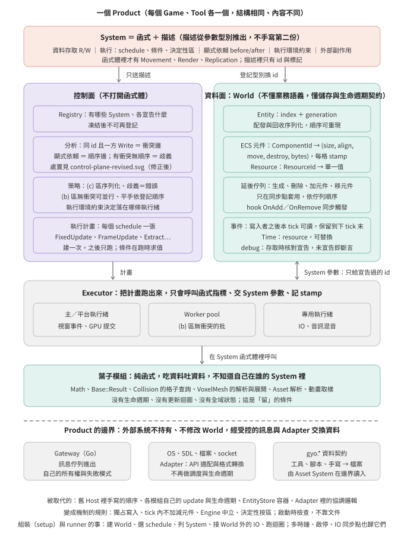
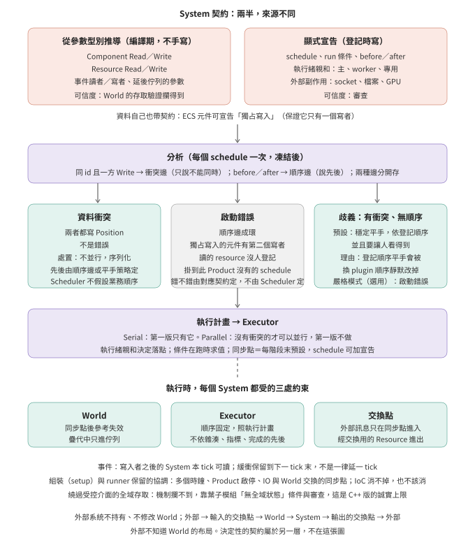
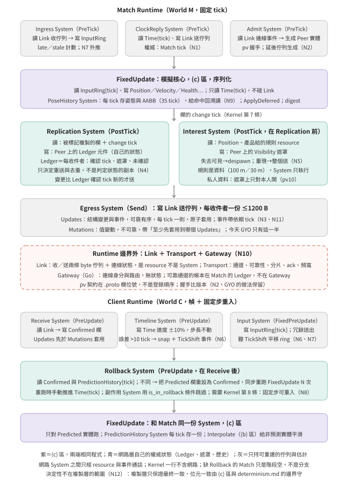

# 機制設計稿：把 Bevy 的抽象能力帶入 GYO

更新：2026-11-11。Owner：架構（架構師會話）。**性質：設計稿 v0.1，概念基準，未定案、未開工。**
起點：使用者的「GYO 架構設計思想」Concept Draft v0.2（`~/Documents/Blog/GYO 架構設計思想.md`，2026-11-11 提供）。
本稿把架構師對該文的理解、三張架構圖、以及使用者提供的審查修正寫成一份文件；取代 [blueprint.zh-Hant.md](blueprint.zh-Hant.md) 成為本線的基準，blueprint 降為輸入（它沒有契約分類與 Executor 的分離，但 K1–K8、各層不變量、反例清單仍有效）。

使用者 2026-11-11 的立場：**要的是 Bevy 那種抽象能力（World／System Contract／Scheduler／Executor），帶入現有 GYO，不是 GYO2；架構改造完成前，功能線停。** 停的定義、AGENTS §2 條文、PR 處置都還沒定（見 HANDOFF）。

## 1. 問題與要做的判斷

**能力**：資料放 World；操作寫成帶存取宣告的 System；Scheduler 只看「誰讀誰寫、誰先誰後、什麼條件跑」就決定順序與並行，不懂內容。這是運轉機制層面的能力，不是一個新模組。

**GYO 為什麼沒有**（v0.2 第一、十節；已觀測，不是預測）：每個模組自己決定怎麼被更新，Host 用手接。順序寫在 PvpApplication 的主迴圈與 Match 的 tick 迴圈裡，是程式碼不是資料；EntityStore 是容器，沒有 System；Threads 是具名角色執行緒，不是契約。每加一個模組就改一次 Host、寫一個 Adapter。

**判斷的形狀**（v0.2 第八、十一節推出）：不是「整個引擎二選一」，而是分層。
- 組織層（Host、生命週期、Registry、Scheduler、Executor）：無論哪條路都是新寫。
- 葉子模組（純函式，吃資料吐資料）：無論哪條路都原樣留在契約後面。
- 中間層（現有模組的更新介面與資料取得方式）：逐模組判斷「包裝」還是「重寫」，判準是 v0.2 第十一節的契約可靠性：這個模組的實際存取能不能被一份契約框住。

**判斷需要的三樣輸入**（順序：1 與 2 可並行，3 等 1）：
1. 機制的規格（本稿是它的概念基準；正式規格每部件一節：資料模型／操作／不變量／C++ 實現手段／Bevy 對照與不採的理由）。
2. 契約可靠性的 spike：C++ 能不能從函式簽名推出存取描述、受限句柄能不能擋住繞路，MSVC 與 Clang 都要成立。證明不了，中間層只能全部重寫。
3. 現有模組對規格的審查：每個模組答三問（有沒有自己的生命週期或更新迴圈；實際存取能不能被契約框住；是不是純函式），產出「留／包／重寫」加理由。

## 2. 機制的骨架

一條推導鏈，每一環都不含業務：

```text
型別 ──登記──▶ id
函式簽名 ──編譯期──▶ 存取集合 {reads, writes}
存取集合 ＋ 顯式約束 ──分析──▶ 衝突邊、順序邊
邊 ＋ 執行策略 ──▶ 執行計畫（每個 schedule 一張）
計畫 ──Executor──▶ 在對的執行緒呼叫函式指標、交受限句柄、記 change tick
```

World 只存「id 對應到一段有 size／align／move／destroy 規則的位元組」，加 change tick、延後佇列、事件緩衝、Time resource。Scheduler 看到的 MovementSystem 就是「寫 7、讀 3」。



圖 1 的要點：
- System ＝ 函式 ＋ 描述，描述從參數型別推出，不手寫第二份。函式體裡才有 Movement、Render、Replication。
- 控制面不打開函式體；資料面不懂業務語義，但懂儲存與生命週期契約（審查修正 5）。
- Executor 三種落點：主／平台執行緒、worker pool、專用執行緒；由顯式的執行緒親和契約決定。
- 葉子模組「留」的三個否定條件：沒有生命週期、沒有更新迴圈、沒有全域狀態。
- Runtime 邊界：外部系統不持有、不修改 World，經受控的訊息與 Adapter 交換資料（審查修正 6）。Gateway → 輸入佇列 → Ingress → World → 模擬 → Egress → 輸出佇列 → Gateway。
- Host 剩下：建 World、選 schedule、列 System、接外部服務、跑迴圈。**多個時鐘的協調、Runtime 啟停、IO 與 World 交換的同步點仍是 Host 的本職**，IoC 消不掉也不該消。

## 3. 契約與控制面（含審查修正）

使用者 2026-11-11 提供一份對圖 1 的審查，指出 4 處修正與 2 處補充；本節全部採納，並加架構師的兩條主張。修正後的控制面：



### 3.1 契約分兩半（修正 4）

| 來源 | 內容 | 可信度 |
|---|---|---|
| 從參數型別推導（編譯期） | Component R／W、Resource R／W、事件讀者／寫者、延後佇列句柄 | World 的 debug 存取核對攔得到（未宣告的 id 即斷言） |
| 顯式宣告（登記時） | schedule、run 條件、before／after、執行緒親和、外部副作用（socket、檔案、GPU）、決定性區 (c)／(b) | 審查 |

資料自己也帶契約：欄可宣告**獨占寫入**。進 authority digest 的欄預設獨占，這就是 AGENTS §3「狀態的權威只有一個」變成機制的方式。

### 3.2 分析的三種結果（修正 1、2）

衝突邊與順序邊語義不同、分開存：衝突邊只說「不能同時」，順序邊說「先後」。Scheduler 不假設業務順序。

| 結果 | 例 | 處置 |
|---|---|---|
| 資料衝突 | Movement 與 Physics 都寫 Position | 不是錯誤。不並行，序列化；先後由順序邊或平手策略定 |
| 啟動錯誤 | 順序邊成環；獨占寫入的欄有第二個寫者；讀的 resource 沒人登記；掛到此 Runtime 沒有的 schedule | 錯不錯由對應契約定，不由 Scheduler 定 |
| 歧義（有衝突、無順序） | 兩個寫者、沒人寫 before／after | **(c) 區：啟動錯誤**，要人寫順序；(b) 區：穩定平手，依登記順序 |

架構師的主張 A：(c) 區的歧義是啟動錯誤而不是靜默平手。登記順序平手雖然決定性，但換一下 plugin 的加入順序，模擬結果就變了，而且沒有任何東西會報錯。

原圖「同階段兩個寫者＝啟動錯誤」太嚴，改為上表（審查修正 1）。

### 3.3 執行策略與決定性分離（修正 3）

Executor 的 Serial／Parallel 是策略，不是決定性本身。序列化只是決定性的必要條件之一；PR #177 的證據：GYO 今天就是單執行緒序列化，win1 仍有 2 步輸入、狀態、位置全同而 sweep_fraction 差 1～4 ULP。

決定性 (c) 區 ＝ 四處各一條契約：

| 處 | 契約 | 對應 |
|---|---|---|
| World | 疊代依 index；同步點後所有參考失效；疊代中只進佇列；佇列依順序套用 | 審查補充 5 |
| Executor | 順序固定；(c) 的時間只來自兩個來源：World 的 domain tick，與被記錄的 boundary 輸入（Host 每次喚醒取樣一次的 `HostClockSample`、隨每筆輸入進 ring 的到達時刻），(c) System 自己讀時鐘仍禁止（使用者 2026-11-11 改，原文「Time 只來自 tick」；spec K.3 第 11 項）；亂數狀態是每實體的 (c) 元件、種子進 digest（spec X20，原文「RNG 是 resource」） | Kernel 第 8 條；determinism.md DI 4 |
| Ingress | 外部訊息只在同步點寫入 InputRing[tick]；(c) 區 System 不碰 Link；到達時機不影響結果 | v0.2 第十節 10.3 |
| Math／編譯 | 自己的 Sin／Cos（E1）；fp-contract 旗標順序（E2）；三平台 golden；E0 先找 ULP 來源 | determinism.md |

架構師的主張 B：(c) 區開 Parallel 的唯一條件是有「與 Serial 逐位元相同」的守衛測試（比照 StaticAabbGrid 以「與線性掃描等價」當契約）。沒有守衛就不開；否則「能證明就能並行」會成為之後每個會話開並行的理由。

### 3.4 事件與同步點（補充 6）

- 事件：寫入者之後的 System **本 tick 就可讀**；緩衝保留到下一 tick 末尾，只是為了讓跨 tick 的讀者不漏。不是一律延一 tick（原圖照 Bevy 雙緩衝畫過頭）。
- 延後佇列：每個階段結束是預設同步點；schedule 可以多宣告。每個 schedule 何時套用佇列、何時交換事件緩衝，要寫在 schedule 的定義裡。

### 3.5 C++ 的誠實上限

從簽名推存取集合，模板做得到。擋住繞路存取做不到絕對：拿到參考就能存指標，全域變數永遠在那裡。能做的三層：API 讓繞路寫起來很醜；debug 建置在 World 的每次存取核對宣告；剩下靠審查。`GlobalCache::Update()` 那種副作用，機制攔不到，只能靠葉子模組「無全域狀態」的條件與審查。Bevy 自己也留了 unsafe 的後門。

## 4. 網路作為機制上的 System

來源：[networking.zh-Hant.md](networking.zh-Hant.md)（replicon 與 lightyear 的研究線）。它們三萬多行接進 Bevy 時引擎一行沒改；它們用到引擎的八件事就是機制必須提供的最小集合，全部已在圖 1 內。所以網路不在機制裡，是機制上的 System。



圖 3 的四處架構師理解：
1. **Ledger 與 Visibility 遮罩是元件，掛在 Peer 實體上**：自然每收件者一份、隨 Peer 的生成與刪除走延後佇列、受獨占寫入檢查。它們是複製層自己的狀態，不是 Match 判定狀態的副本（N4）。直接對應 pv10 四件結構裡的三件：可靠事件串流、相關性選擇、私人資料。
2. **Replication 讀 change tick，不自己記「上次送了什麼」**：差分變成「欄的 tick 比 Ledger 的確認 tick 新就送」。今天 GYO 的 snapshot 是 latest-wins 全量。
3. **Match 與 Client 的 FixedUpdate 是同一份 System**：Client 多的只是 Rollback 與 PredictionHistory；Rollback 依賴 Kernel 第 8 條（固定步可在同一幀重入、時間只來自 tick）。今天 Client 預測是另一份手寫程式，靠 digest 證明一致。
4. **Link 是 resource 不是 System**：兩條 byte 佇列加連線狀態，由專用執行緒在幀邊界填；Ingress 與 Egress 在 Runtime 內讀寫它。這是 v0.2 第八節「訊息邊界」在圖上的位置。

與今天的差距（研究線總表壓成三件）：缺可靠有序通道（Updates 那一半）；缺帳本與遮罩；缺 TickShift 廣播給所有以 tick 索引的 buffer。輸入、命中回溯、契約在 .proto 三件今天就一致。

留給使用者的兩個決定（機制沒有改變它們）：可靠串流的帳本放 Match 還是 Gateway（圖畫 Match，Gateway 維持無狀態）；要不要採「結構走可靠、值走不可靠」的兩通道分流（圖畫採）。

N12 與 PR #177 說的是同一件事：複製層不保證決定性，只保證最終一致。改造後位元一致的責任完全落在 (c) 區與四處契約上，網路層不再有機會「在上面補」；win1 的 ULP 差異不會因改造消失，E0 偵測批仍需要。

## 5. 它會把哪些「規則」變成「機制」

| 今天的規則（文字守） | 改造後（啟動時檢查） |
|---|---|
| AGENTS §3 狀態的權威只有一個 | 進 digest 的欄宣告獨占寫入；第二個寫者是啟動錯誤 |
| entity-model E-12 tick 內不改欄 | 結構變更只能進佇列，同步點套用 |
| Engine 中立 | Kernel 的型別表只有 id，不可能出現產品型別 |
| 決定性靠自律 | (c) 區的四處契約 ＋ Executor Serial 策略 ＋ 歧義即錯誤 |

每把一條規則變成機制，之後每個會話要讀的規則就少一條（v0.2 第十二節第 8 條 Mechanism over Convention）。

## 6. 它不解決什麼

- 不會自動給出業務順序：Physics 在 Gameplay 前必須有人宣告。
- 不會自動給出決定性：並行與否是策略，不是圖的性質；位元一致要四處契約。
- 不會把 Gateway 與非同步 IO 變成 ECS：那是訊息邊界（v0.2 第八節）。
- 不會解決 pv10 的協議設計：只給它乾淨的位置（Replication 讀 change tick）。
- 不會消掉 Host 的多時鐘協調、啟停、IO 同步點。

## 7. 改造的性質與風險

GYO 的名詞大多留得住：gyo.* 資料契約、Collision 的格子、VoxelMesh 的展開、Math、Base 的 Result。被換掉的是動詞，「東西怎麼跑」。

停功能線的理由不是改造很大，而是每條功能線都在往舊動詞上加東西，改造完還得再搬一次。

風險：
- v0.2 第十三節第 7 問「統一契約到底減少多少整合成本」是假說，代價也是真的（每個 System 自我描述、型別擦除、多一層間接）。GYO 現在一個產品、三個 host，收益主要來自 Match 與 Client 預測共用模擬核心、編輯器直接重用 Engine 的 System、規則變機制三處。要用 v0.2 第十節的四個場景驗，不靠圖。
- 改造做到一半停下，GYO 就有兩個動詞並存。所以改造的形狀必須是**一個 host 要嘛整個跑在 Scheduler 上，要嘛不跑**，沒有半個 host。
- C++ 契約可靠性（§3.5）是中間層成本的決定變數，先 spike。

## 8. 判準（之後每張卡片用）

> 真正值得追求的，不是讓所有模組都成為 System，而是讓需要被 Runtime 調度的工作，都能遵守一套可驗證的共同契約。（使用者提供的審查，2026-11-11）

葉子模組維持普通 C++ 函式或函式庫，只有需要接入 Runtime 調度時才包裝成 System。

## 9. 本稿不做的事

- 不決定機制的 C++ 介面（正式規格與 spike 之後）。
- 不改任何程式、不改 pv9、不改 Gateway。
- 不決定停功能線的定義、AGENTS §2 條文、DET-0～DET-3、開放 PR 的處置（使用者）。
- 不評估第三方 ECS 函式庫（v0.2 第十一節：先確認責任邊界再選庫；評估卡 PR #176 另行）。
